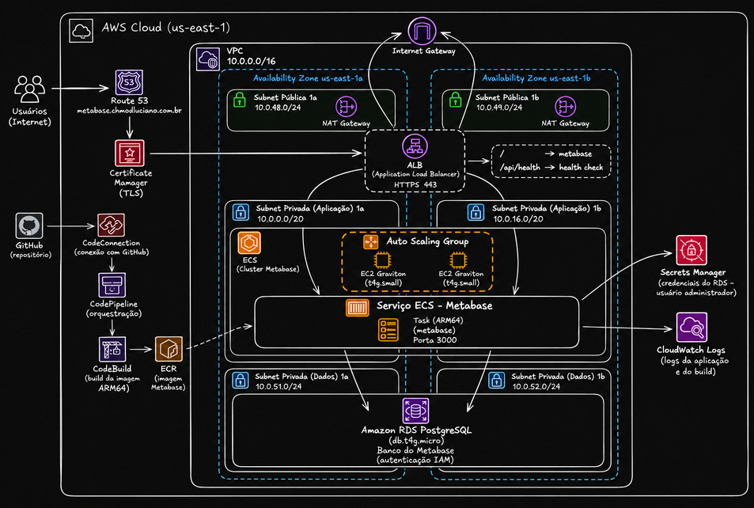

# AWS ECS — Metabase com RDS IAM

Laboratório Terraform para executar Metabase sobre EC2 Graviton, com PostgreSQL no Amazon RDS e autenticação IAM no banco da aplicação. CodePipeline recebe o código do GitHub, CodeBuild constrói a imagem ARM64 e publica no ECR. O acesso administrativo ao banco usa DBeaver com port forwarding pelo Session Manager de uma EC2 do próprio cluster.

## Arquitetura



O ALB público encaminha as requisições para o Metabase. Hosts e tasks ECS ficam em duas subnets privadas, com saída por um NAT Gateway em cada AZ. O RDS usa subnets isoladas. A VPC é criada neste projeto.

| Componente | Configuração do sandbox |
| --- | --- |
| ECS sobre EC2 | Uma `t4g.small` inicial, ASG com mínimo 1 e máximo 3 |
| Metabase | `v0.64.3`; zero tasks na preparação, uma após configurar o banco |
| Reserva por task | 1.024 unidades de CPU e 1.536 MiB de memória |
| Banco | RDS PostgreSQL `18`, `db.t4g.micro`, Single-AZ |
| Backups | Retenção de um dia |
| Saída | Dois NAT Gateways, um por AZ |
| Entrada | ALB público, ACM e `metabase.chmodluciano.com.br` |
| Administração do banco | Session Manager na EC2 do cluster, com túnel local para o RDS |

A rede em duas AZs permite distribuir recursos, mas o sandbox com um host e RDS Single-AZ não oferece alta disponibilidade. O Capacity Provider escala os hosts conforme a demanda das tasks; a contagem do serviço é definida por `metabase_task_desired`, sem auto scaling de tasks.

O RDS armazena usuários, dashboards, perguntas e configurações do Metabase. Bancos analisados são fontes de dados cadastradas depois na aplicação. Para acessar outras fontes, acrescente regras de rede específicas conforme necessário.

## Estrutura

Os arquivos Terraform ficam na raiz e compartilham provider, backend e estado. `variables.tf` contém apenas as declarações; os valores de entrada ficam em `live/sandbox/terraform.tfvars`. Os CIDRs estão nos recursos de rede. Os recursos usam `project_name` na nomenclatura e tags `Name`, `Environment` e `Terraform`.

| Arquivos | Responsabilidade |
| --- | --- |
| `backend.tf`, `live/sandbox/backend.tfvars` | Estado remoto S3 e locking |
| `vpc.tf`, `internet_gateway.tf`, `*_subnets.tf`, `nat_gateway.tf` | VPC, subnets e rotas |
| `ecs_cluster.tf`, `ecs_iam.tf`, `ecs_service.tf`, `ecs_task_definition.tf` | Hosts, ASG, Capacity Provider, IAM e aplicação |
| `rds.tf` | PostgreSQL, autenticação IAM e senha administrativa gerenciada pelo RDS |
| `alb.tf`, `route53.tf`, `security_group.tf` | HTTPS, DNS e regras de rede |
| `codebuild*.tf`, `codepipeline*.tf`, `ecr.tf`, `buildspec.yml` | Build e entrega |
| `templates/ecs_user_data.sh.tftpl` | Configuração do agente ECS |
| `docs/prepare-rds-iam.sql` | Preparação manual do usuário PostgreSQL pelo DBeaver |

O build está em `buildspec.yml`, carregado pelo Terraform com `file()`. Mudanças no buildspec exigem apply; o Dockerfile vem do Source da pipeline e exige commit e push. `metabase_version` define a imagem base e é passado ao CodeBuild como `METABASE_VERSION`, ao Docker como `--build-arg` e recebido por `ARG METABASE_VERSION` no Dockerfile. O `ARG` não define uma segunda versão. Durante o build, a imagem recebe a cadeia pública de certificados do RDS.

## Autenticação no banco

A aplicação usa `MB_DB_AWS_IAM=true`, com tokens renovados pelo Metabase e credenciais temporárias da task role. Não há `MB_DB_PASS` na task definition. A policy permite `rds-db:connect` somente para o resource ID do RDS e o usuário definido em `db_username`. A conexão da aplicação exige `sslmode=verify-full` e valida o certificado e o hostname do RDS.

O administrador `dbadmin` tem senha gerenciada pelo RDS no Secrets Manager. O Terraform mantém a referência ao segredo; a task do Metabase e o instance profile da EC2 não recebem acesso a ele. A pessoa que prepara o banco consulta o segredo com sua própria identidade AWS e executa o SQL pelo DBeaver. Habilitar IAM no RDS e na policy não cria o usuário PostgreSQL nem concede o papel `rds_iam`; essa etapa é manual.

## Custos

Há cobrança mesmo com zero tasks ECS. Considere EC2, EBS, ALB, dois NAT Gateways, IPv4 público, RDS, Route 53, Secrets Manager, armazenamento, logs e execuções da pipeline. Confira as condições da conta, cotas e versões disponíveis na região antes do apply. Remova os recursos ao terminar.

## Restrições do plano gratuito

Contas no Free plan podem bloquear tipos de instância e retenções de backup mesmo quando há créditos disponíveis. O sandbox usa `t4g.small` (ARM64) e retenção de backup de um dia. Consulte os tipos elegíveis na região:

```bash
aws ec2 describe-instance-types \
  --region us-east-1 \
  --filters Name=free-tier-eligible,Values=true Name=processor-info.supported-architecture,Values=arm64 \
  --query 'InstanceTypes[].{Tipo:InstanceType,MemoriaMiB:MemoryInfo.SizeInMiB}' \
  --output table
```

A `t4g.small` tem 2 GiB; a task reserva 1.536 MiB e a JVM usa heap máximo de 1.024 MiB, deixando espaço para memória nativa e para os agentes do host. É um dimensionamento para testes leves: acompanhe a memória durante as migrações e consultas. Para ampliar a instância além dos tipos permitidos, altere o plano da conta antes de mudar o dimensionamento. O RDS usa `db.t4g.micro`, uma classe disponível no Free plan. Ela tem apenas 1 GiB de memória, e a AWS orienta reservar entre 300 e 1.000 MiB adicionais para autenticação IAM confiável. Isso deixa pouca margem para o PostgreSQL: use somente para testes leves e acompanhe `FreeableMemory`, conexões e reinicializações. Se houver falta de memória, será necessário ampliar o banco em uma conta com plano que permita classes maiores. [Classes do Free plan](https://aws.amazon.com/rds/free/) e [requisitos de memória do IAM](https://docs.aws.amazon.com/AmazonRDS/latest/UserGuide/UsingWithRDS.IAMDBAuth.html).

Se um apply falhar parcialmente, mantenha o state, corrija os valores e gere um plano novo. Não reutilize o plano anterior nem destrua os recursos já criados apenas para tentar novamente.

## Preparar

São necessários Terraform >= 1.10, AWS CLI, Session Manager plugin e DBeaver com driver PostgreSQL. O build padrão roda no CodeBuild; Docker com suporte a ARM64 só é necessário para build manual.

```bash
export AWS_PROFILE=seu-profile
export AWS_REGION=us-east-1
export AWS_DEFAULT_REGION="$AWS_REGION"
aws sts get-caller-identity
session-manager-plugin --version
```

Ajuste região, domínio, repositório e branch em `live/sandbox/terraform.tfvars`. Preencha o bucket existente em `live/sandbox/backend.tfvars`; ele deve ter versionamento, bloqueio público e permissões restritas. A key deste projeto é `aws-ecs-metabase/sandbox/terraform.tfstate`, separada de outros projetos. O bucket de artefatos da pipeline é criado por este projeto e é diferente do backend.

```bash
terraform init -backend-config=live/sandbox/backend.tfvars
terraform fmt -check -recursive
terraform validate
```

Se já houver recursos com state local, migre esse state usando `terraform init -migrate-state -backend-config=live/sandbox/backend.tfvars`.

Na primeira implantação, mantenha:

```hcl
image_tag  = "initial"
metabase_task_desired = 0
```

`initial` é apenas uma tag inicial de referência; nenhuma imagem é criada automaticamente com esse nome. Inicie a aplicação somente depois de preparar o usuário PostgreSQL e publicar a imagem.

## Preparar o domínio e criar a infraestrutura

`dns_zone_name` define a zona pública e `domain_name` define o endereço da aplicação. Substitua os exemplos pelo seu domínio. Se a zona já existe, importe-a antes do primeiro apply:

```bash
aws route53 list-hosted-zones-by-name --dns-name chmodluciano.com.br
terraform import -var-file=live/sandbox/terraform.tfvars aws_route53_zone.metabase ID_DA_ZONA
```

Uma zona com somente NS e SOA exige apenas esse import. Se os registros do certificado ou da aplicação já existem, importe-os também. Criar outra zona com o mesmo domínio gera novos nameservers e não reutiliza a delegação existente.

Para um domínio novo, crie a zona antes da validação do certificado:

```bash
terraform apply -var-file=live/sandbox/terraform.tfvars -target=aws_route53_zone.metabase
terraform output -json name_servers
```

Informe no registrador os quatro nameservers retornados e aguarde a delegação. O uso de `-target` é apenas para essa preparação inicial. Depois, aplique o projeto completo:

```bash
terraform plan -var-file=live/sandbox/terraform.tfvars -out=sandbox.tfplan
terraform apply sandbox.tfplan
```

ACM aguarda a validação DNS. HTTP redireciona para HTTPS. A zona tem `prevent_destroy` para preservar o domínio compartilhado.

## Preparar o PostgreSQL pelo Session Manager e DBeaver

Execute os comandos abaixo na sua máquina, na raiz do repositório. A sessão encaminha `127.0.0.1:5432` para a porta `5432` do RDS através da EC2 privada do cluster. Não é necessário abrir SSH nem expor o RDS à internet.

### 1. Identificar o host ECS e o endpoint RDS

```bash
CLUSTER=$(terraform output -raw cluster_name)
RDS_HOST=$(terraform output -raw rds_endpoint)

aws ec2 describe-instances \
  --filters "Name=tag:Name,Values=${CLUSTER}-ecs" "Name=instance-state-name,Values=running" \
  --query 'Reservations[].Instances[].{InstanceId:InstanceId,AZ:Placement.AvailabilityZone,IP:PrivateIpAddress}' \
  --output table

terraform output -raw db_name
terraform output -raw db_username
terraform output -raw db_master_secret_arn
```

Escolha uma EC2 do cluster e informe seu ID:

```bash
INSTANCE_ID=i-0123456789abcdef0 # Substitua pelo ID retornado.
aws ssm describe-instance-information \
  --filters "Key=InstanceIds,Values=$INSTANCE_ID" \
  --query 'InstanceInformationList[].{InstanceId:InstanceId,Status:PingStatus,Agent:AgentVersion}' \
  --output table
```

O host precisa aparecer `Online`, com SSM Agent >= `3.1.1374.0`. O instance profile já possui `AmazonSSMManagedInstanceCore`, e as subnets privadas têm saída HTTPS pelos NAT Gateways. Sua identidade local precisa de permissões para consultar EC2/SSM e iniciar uma sessão usando o documento `AWS-StartPortForwardingSessionToRemoteHost`, além de encerrar sua sessão. O acesso ao segredo administrativo exige `secretsmanager:GetSecretValue`; uma chave KMS própria também pode exigir `kms:Decrypt`.

As regras em `security_group.tf` permitem saída do SG do host ECS para o SG do RDS e entrada no RDS a partir desse host, ambas em TCP/5432. O tráfego encaminhado sai pela EC2; a regra para o SG da task, sozinha, não atende esse túnel.

### 2. Abrir o túnel local

```bash
aws ssm start-session \
  --target "$INSTANCE_ID" \
  --document-name AWS-StartPortForwardingSessionToRemoteHost \
  --parameters "{\"host\":[\"$RDS_HOST\"],\"portNumber\":[\"5432\"],\"localPortNumber\":[\"5432\"]}"
```

Mantenha esse terminal aberto enquanto usar o DBeaver. Se a porta local 5432 já estiver ocupada, use `15432` em `localPortNumber` e na conexão do DBeaver. O destino remoto permanece na porta 5432.

### 3. Consultar a credencial administrativa

Com sua identidade AWS, abra Secrets Manager na região do projeto, localize o segredo indicado por `db_master_secret_arn` e use **Retrieve secret value**. Utilize `username` (`dbadmin`) e `password` na conexão administrativa do DBeaver. Não copie a senha para Terraform, comandos, scripts ou arquivos do repositório; deixe desmarcada a opção de salvar a senha no DBeaver.

A senha administrativa serve para a preparação manual. O usuário `metabase` usa IAM e não recebe essa senha. Não conceda `rds_iam` a `dbadmin`, pois no PostgreSQL a autenticação IAM passa a ter precedência sobre a senha para usuários com esse papel.

### 4. Configurar o DBeaver

Baixe na máquina local o bundle público de certificados do RDS:

```bash
curl --fail --location https://truststore.pki.rds.amazonaws.com/global/global-bundle.pem \
  --output /tmp/rds-global-bundle.pem
```

Crie uma conexão PostgreSQL:

| Campo | Valor |
| --- | --- |
| Host | `127.0.0.1` |
| Port | `5432`, ou `15432` se alterou a porta local |
| Database | Valor de `db_name`; padrão `metabase` |
| Username | `dbadmin` |
| Password | Senha consultada no Secrets Manager |
| SSH tunnel | Desativado; o túnel já está aberto pela AWS CLI |

Nas propriedades do driver, configure `sslmode=verify-ca` e `sslrootcert=/tmp/rds-global-bundle.pem` (caminho absoluto do arquivo local). Essa configuração criptografa a conexão e valida a cadeia do certificado. Como o host usado pelo DBeaver é `127.0.0.1`, ele não coincide com o nome do certificado RDS; `verify-full` falharia com esse endereço. A aplicação continua usando `verify-full` com o endpoint real.

Para também validar o hostname no DBeaver, mapeie temporariamente o endpoint real do RDS para `127.0.0.1` no arquivo hosts local, use esse endpoint como Host no DBeaver e selecione `sslmode=verify-full`. O destino passado ao Session Manager continua sendo o endpoint real, resolvido pela EC2. Remova o mapeamento local ao encerrar. Não use uma fábrica SSL que ignore certificados.

Teste a conexão e confirme que está no banco `metabase`, como `dbadmin`.

### 5. Executar o SQL de preparação

Abra [docs/prepare-rds-iam.sql](docs/prepare-rds-iam.sql) no editor SQL dessa conexão e execute o script. Com os valores padrão:

```sql
DO $$
BEGIN
  IF NOT EXISTS (SELECT 1 FROM pg_roles WHERE rolname = 'metabase') THEN
    CREATE ROLE metabase LOGIN;
  END IF;
END
$$;

GRANT rds_iam TO metabase;
GRANT CONNECT, CREATE, TEMPORARY ON DATABASE metabase TO metabase;
GRANT USAGE, CREATE ON SCHEMA public TO metabase;
```

Se alterou `db_name` ou `db_username`, ajuste os identificadores do SQL. Execute conectado ao banco da aplicação, pois `public` pertence ao banco da conexão atual. O script foi feito para a preparação de um banco novo; ele não transfere objetos de instalações anteriores. O Metabase será proprietário dos objetos que criar durante suas migrações.

As consultas ao final do arquivo devem retornar `rolcanlogin=true`, `iam_enabled=true` e todas as permissões verificadas como `true`. Use commit se o auto-commit estiver desativado. Essas consultas confirmam a configuração SQL; a conexão IAM será validada quando a aplicação iniciar.

Desconecte o DBeaver e encerre o túnel com `Ctrl+C` no terminal.

## GitHub e primeira entrega

```bash
terraform output -raw connection_arn
terraform output -raw pipeline_name
```

No console AWS, abra Developer Tools → Settings → Connections e conclua a autorização GitHub. A conexão precisa passar de `PENDING` para `AVAILABLE`. Envie o código para a branch configurada; o Terraform não faz o push. Depois, execute a pipeline:

```bash
aws codepipeline start-pipeline-execution --name "$(terraform output -raw pipeline_name)"
```

O fluxo é Source → Build → Deploy. CodeBuild publica uma tag imutável baseada no commit e no número do build, disponível nos logs e no artefato `release.json`. `metabase_version` seleciona a versão oficial da imagem base; `image_tag` identifica a imagem construída neste projeto.

Após concluir a preparação SQL e publicar a imagem, registre em `live/sandbox/terraform.tfvars` a tag real publicada e aumente a contagem:

```hcl
image_tag  = "a1b2c3d4e5f6-1" # Substitua pela tag real publicada no ECR.
metabase_task_desired = 1
```

A pipeline associa sua revisão ao serviço mesmo com zero tasks. Terraform ignora mudanças em `task_definition` do serviço para preservar essa associação. Confirme no ECS que a revisão associada usa a imagem publicada antes de iniciar as tasks.

```bash
terraform plan -var-file=live/sandbox/terraform.tfvars -out=sandbox.tfplan
terraform apply sandbox.tfplan
terraform output -raw url
```

Abra a URL e conclua o assistente inicial. O ALB verifica `/api/health`; o grace period permite as migrações iniciais. Consulte `/ecs/ecs-metabase/main` no CloudWatch para acompanhar a inicialização.

## Entregas seguintes

A pipeline publica a imagem e atualiza a revisão associada ao serviço ECS. O serviço ignora alterações de `task_definition` no Terraform. Para aplicar mudanças de CPU, memória ou variáveis de ambiente, aplique a nova task definition com Terraform e associe explicitamente sua revisão ao serviço com `aws ecs update-service --task-definition ARN_DA_REVISAO`, informando cluster e serviço. Revise a imagem da revisão antes de associá-la. O deploy padrão ECS da pipeline parte da definição associada ao serviço.

O sandbox encerra a task anterior antes de iniciar a próxima (`minimum=0`, `maximum=100`), causando uma interrupção temporária. Dimensione hosts, tasks, RDS Multi-AZ e política de deployment conforme os requisitos do ambiente.

## Diagnóstico

| Sintoma | Verificação |
| --- | --- |
| `TargetNotConnected` | EC2 correta, região/profile, status Online, SSM Agent, instance profile e saída HTTPS |
| Porta local ocupada | Use `15432` no túnel e DBeaver |
| Timeout ao conectar ao RDS | Endpoint, resolução DNS na EC2 e regras host → RDS TCP/5432 |
| Erro de certificado no DBeaver | Bundle local, caminho absoluto e configuração de hostname/sslmode |
| `permission denied for schema public` | Execute o GRANT no banco correto e confirme o commit |
| Falha IAM no Metabase | `rds_iam`, nome exato do usuário, resource ID na policy e revisão da task |
| Task não inicia | Imagem publicada, revisão do serviço, capacidade/memória do host e logs ECS |

## Limpeza

O laboratório permite apagar imagens ECR e artefatos S3 e não cria snapshot final do RDS. Exporte os dados que quiser preservar antes da remoção. Encerre sessões administrativas antes de destruir o host.

Para preservar a zona compartilhada, retire somente sua associação ao estado antes do destroy. Os registros ACM e o alias da aplicação continuam gerenciados e serão excluídos:

```bash
terraform state rm aws_route53_zone.metabase
terraform plan -destroy -var-file=live/sandbox/terraform.tfvars
terraform destroy -var-file=live/sandbox/terraform.tfvars
```

Não execute apply normal entre esses comandos. Para reutilizar o projeto, importe a zona novamente antes de aplicar. NS/SOA e registros não gerenciados pelo projeto permanecem na zona. O bucket do backend também permanece.

## Referências

- [Metabase: variáveis de ambiente e MB_DB_AWS_IAM](https://www.metabase.com/docs/latest/configuring-metabase/environment-variables)
- [Metabase: banco da aplicação e TLS](https://www.metabase.com/docs/latest/installation-and-operation/configuring-application-database)
- [AWS: iniciar sessão e port forwarding para host remoto](https://docs.aws.amazon.com/systems-manager/latest/userguide/session-manager-working-with-sessions-start.html)
- [AWS: autenticação no RDS](https://docs.aws.amazon.com/AmazonRDS/latest/UserGuide/database-authentication.html)
- [DBeaver: configuração SSL](https://dbeaver.com/docs/dbeaver/SSL-Configuration/)
- [pgJDBC: validação de certificados](https://jdbc.postgresql.org/documentation/ssl/)
